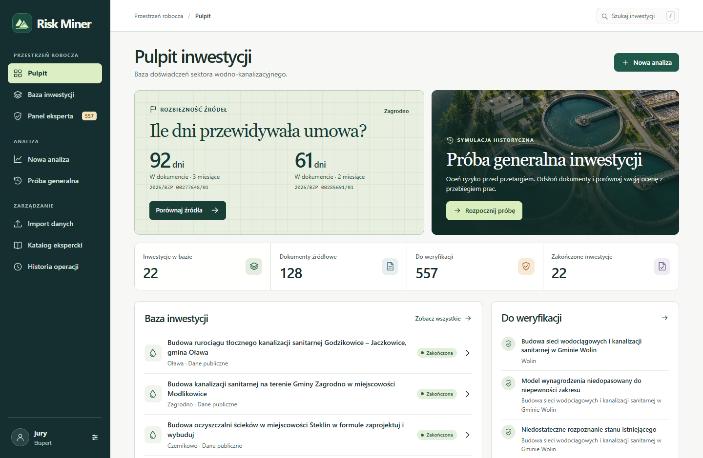

# Risk Miner — HackNation 2026

Zespół KryptoTrop. Zadanie Ministerstwa Funduszy i Polityki Regionalnej.

Risk Miner pomaga osobie przygotowującej inwestycję wodociągowo-kanalizacyjną ustalić, o co zapytać projektanta przed przetargiem. Łączy źródła publiczne z dokumentacją samorządu, pokazuje podobne kontrakty i pozwala obronić każde ustalenie przed ekspertem. Wynik można włączyć do akt jako edytowalną kartę Word.

**[Prezentacja projektu (PDF)](deliverables/prezentacja-risk-miner.pdf)** · **[Otwórz demo Risk Minera](https://spouse-advocate-iron-solutions.trycloudflare.com/)**

Demo korzysta z tymczasowego tunelu. Do logowania służy token przekazany jury przez zespół.



## Pierwsze uruchomienie

Na nowym stanowisku z Docker Compose i Pythonem 3.12 wykonaj w katalogu projektu poniższe polecenia. Polecenie bootstrap korzysta z biblioteki standardowej Pythona, tworzy lokalny token i plik konfiguracyjny. Seed importuje dostarczony arkusz i załączniki oraz odtwarza kandydatury powiązań z kopii publicznych danych.

```sh
python -m riskminer.cli bootstrap
docker compose up -d --build
docker compose exec app python -m riskminer.cli seed
```

Po uruchomieniu otwórz [lokalną aplikację](http://127.0.0.1:8180) i zaloguj się tokenem z pliku `var/pierwszy-dostep.txt`.

## Pierwsze pięć minut

1. Na pulpicie otwórz rozbieżność dla gminy Zagrodno. W dwóch ogłoszeniach o wykonaniu tej samej umowy pole 4.2 podaje dwa i trzy miesiące. Otwórz oba dokumenty i porównaj z polem 8.3 pierwotnego ogłoszenia o wyniku. Oddzielnie znajdziesz dostarczony protokół, w którym opisano kolizję z siecią i wysoki poziom wód gruntowych.
2. W panelu eksperta sprawdź proponowane powiązanie. Masz dostęp do identyfikatorów, podstawy dopasowania i dokumentu. Uzasadnienie oraz zmienione przypisanie zostają w historii.
3. W **Nowej analizie** wpisz na przykład „Budowa kanalizacji sanitarnej z przepompownią na terenie z wysokim poziomem wód gruntowych i kolizjami z istniejącą siecią”. Dodaj planowaną liczbę dni lub wstępny dokument. Przejrzyj pytania, przyczyny podobieństwa, liczebność próby i dokumenty.
4. Na świeżej bazie możesz zaznaczyć **Podgląd powiązań po identyfikatorach**, żeby zbadać wpływ jednoznacznych powiązań przed kolejką ocen. Wynik otrzyma oznaczenie robocze. Akceptacji wymaga decyzja eksperta. Pobierz kartę do Worda.
5. W **Próbie generalnej** wybierz projekt i dzień publikacji jego ogłoszenia. Po odsłonięciu porównaj wcześniejsze sygnały z późniejszymi źródłami. Wynik pokazuje także pominięcia i niepotwierdzone wskazania.

## Pokaz testu wrażliwości

W widoku **Nowa analiza** wybierz **Sprawdź przykład umowy na 365 dni**. Formularz uruchamia robocze porównanie dla hipotetycznego kosztorysu 5 mln zł, z podglądem powiązań po identyfikatorach. W panelu **Co zmienia jedna inwestycja?** przełącz termin na koszt lub wybierz inny przypadek. Możesz otworzyć dokument i pobrać aktualny wariant w karcie Word oraz JSON. Obliczenie zmienia wyłącznie zestaw porównawczy. Przy mniej niż trzech pozostałych pomiarach panel podaje liczebność i wstrzymuje wyznaczenie przedziału.

## Dane i wdrożenie

Materiały startowe obejmują 22 rekordy inwestycji, dwa dokumenty eksperckie wykorzystane do opracowania katalogu oraz trzy dokumenty dotyczące konkretnych przypadków. W katalogu `fixtures/starter` są arkusz i te trzy załączniki. Oryginalne pliki zachowują treść. Znormalizowane akapity i wiersze tabel z materiałów eksperckich zachowują nazwę dokumentu i lokalizator.

- [Obsługa, architektura, konfiguracja i kopie zapasowe](docs/wdrozenie.md)
- [Pochodzenie kopii danych i odtwarzanie](fixtures/real/README.md)
- [Sprawdzenie publicznych źródeł i ograniczenia próby](docs/walidacja-zrodel.md)
- [Wykaz zależności i licencji](docs/zaleznosci.md)
- [Raport z testu wydania i materiały dla jury](docs/test-wydania.md)
- [Przegląd techniczny trzech inwestycji](docs/przeglad-trzech-spraw.md)
- [Test w ciemno na ośmiu nowych postępowaniach](docs/test-niezalezny.md)
- [Oddzielny pokaz HTTPS i reset bazy dla jury](docs/pokaz-jury.md)
- [Zestawienie wymagań konkursowych i dowodów realizacji](docs/wymagania-konkursowe.md)

## Praca nad kodem

```sh
python -m venv .venv
# Aktywuj środowisko zgodnie z powłoką systemu.
python -m pip install -r requirements.txt -c constraints.txt
python -m pip install pytest
python -m pytest -q
python -m riskminer.cli seed
python -m uvicorn riskminer.service:app --host 127.0.0.1 --port 8080 --no-proxy-headers
```

W trybie lokalnym aplikacja przyznaje uprawnienia eksperckie połączeniu z interfejsu pętli zwrotnej. Produkcyjny Compose wymaga konta i tokena. Kontener zawiera narzędzia do odczytu starszego DOC i OCR po polsku. Na Windows skany obsługuje również systemowe rozpoznawanie tekstu.
