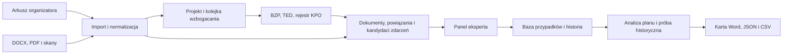

# Wdrożenie i utrzymanie

## Uruchomienie na własnym stanowisku

W katalogu projektu, z Pythonem 3.12 i Docker Compose, wykonaj:

```sh
python -m riskminer.cli bootstrap
docker compose up -d --build
docker compose exec app python -m riskminer.cli seed
```

Pod adresem `http://127.0.0.1:8180/pokaz` dostępne są akta trzech publicznych zamówień. Przestrzeń robocza pod `http://127.0.0.1:8180/` wymaga tokenu zapisanego przez bootstrap w `var/pierwszy-dostep.txt`.

## Pilot pod stałą domeną

Na serwerze z Docker Compose 2.24.4 lub nowszym skieruj domenę na publiczny adres serwera i udostępnij porty TCP 80 oraz 443. Wygeneruj lokalną konfigurację kont poleceniem `python -m riskminer.cli bootstrap`, a następnie dopisz do `.env` zmienną `RISKMINER_DOMAIN` z rzeczywistą nazwą hosta, bez protokołu i ścieżki. Utwórz oddzielne konta dla użytkowników pilotażu zgodnie z instrukcją poniżej.

```sh
docker compose -f compose.yaml -f compose.https.yaml up -d --build
docker compose -f compose.yaml -f compose.https.yaml exec -T app python -m riskminer.cli seed
```

Caddy kończy połączenie TLS i automatycznie uzyskuje oraz odnawia certyfikat dla publicznej domeny. Tylko brama publikuje porty. Aplikacja i baza komunikują się lokalnie na serwerze. Wolumen `dane` zawiera dane aplikacji, a `certyfikaty` stan i klucze bramy. Sprawdź z zewnątrz przekierowanie HTTP do HTTPS, odpowiedź `/healthz` oraz wymaganie tokenu na `/api/state`. Przed dopuszczeniem rzeczywistych danych wykonaj i odtwórz kopię według dalszej instrukcji. Wybór regionu serwera oraz operatora kopii zapasowych należy do instytucji prowadzącej pilotaż. [Dokumentacja HTTPS Caddy](https://caddyserver.com/docs/automatic-https)

## Architektura

Przeglądarka pobiera polski interfejs HTML, CSS i JavaScript z tego samego serwera co API. FastAPI obsługuje operacje użytkownika. Adaptery źródeł wyszukują ogłoszenia BZP, publikacje TED i właściwy dla identyfikatora rejestr regionalny. Parsery zapisują tekst i jego położenie, mechanizm analityczny proponuje zdarzenia, a ekspert rozstrzyga o przyjęciu do bazy. Pliki, dane i dziennik zmian znajdują się w SQLite na wolumenie Docker.



**Model danych.** Projekt ma odrębne rekordy postępowań, publikacji, umów, zmian, pomiarów, źródeł i zdarzeń. Aplikacja waliduje typ oraz przynależność każdego identyfikatora obcego. Jedno postępowanie może zawierać kilka umów. Kandydatura powiązania zachowuje podstawę dopasowania. Decyzja ma wersję, autora, uzasadnienie i historię. Identyfikator analizy wskazuje jej utrwalone wejście i wynik. Próba historyczna utrwala obie fazy we wspólnym zapisie.

**Porównania.** Silnik uwzględnia cechy zakresu i treść dokumentów. Oddziela obserwacje dotyczące umowy od całego przedsięwzięcia. Niepełny materiał daje brak wartości lub zastrzeżenie. Czas, kwota przyznanego wsparcia i wynagrodzenie wykonawcy zachowują swoje znaczenie. Próba historyczna usuwa badany projekt z grupy i ogranicza dowody do dostępnych w dacie odcięcia. Korekty i źródła po tej dacie podlegają dodatkowym warunkom dostępności. Zakres prezentowany przez aplikację opisuje historyczne obserwacje. Liczbie podobieństwa nie przypisuje się znaczenia skalibrowanego prawdopodobieństwa.

**Zasilanie.** Identyczne pliki mają ten sam SHA-256. Powtórzenie importu pozostawia decyzje użytkownika. Zmiana treści ogłoszenia tworzy kolejną wersję dowodu. Import wielu inwestycji z włączonym pobieraniem zakłada trwałe zadanie. Pracownik kolejki rezerwuje pojedyncze pozycje transakcyjnie, a po utracie procesu ponawia je po wygaśnięciu rezerwacji. Błędy źródła są widoczne w zadaniu. Jednostkowe wzbogacenie w interfejsie kończy się podsumowaniem tej operacji.

## Konfiguracja operatora

| Ustawienie | Znaczenie |
|---|---|
| `RISKMINER_ENV=production` | Wymaga skonfigurowanego administratora przy starcie. |
| `RISKMINER_ACCOUNTS` | Obiekt JSON mapujący nazwę użytkownika na rolę i skrót SHA-256 losowego tokena. |
| `RISKMINER_HOSTS` | Lista dozwolonych nazw hosta rozdzielonych przecinkiem. Przy reverse proxy dodaj konkretną domenę i zachowaj 127.0.0.1 dla healthchecku. |
| `RISKMINER_DB` | Ścieżka do bazy. W kontenerze domyślnie `/data/riskminer.sqlite3`. |
| `RISKMINER_WORKER` | Wartość 1 włącza przetwarzanie kolejki. Przy skalowaniu procesów można wyznaczyć instancję obsługującą kolejkę. |
| `RISKMINER_MONITOR_HOURS` | Odstęp monitorowania projektów aktywnych. Domyślnie 6 godzin. Wartość 0 wyłącza cykliczne wzbogacanie. |
| `RISKMINER_MODEL_PROVIDER` | Domyślne `rules` analizuje dokumenty lokalnie. `openai-compatible` uruchamia dodatkową ekstrakcję przez wskazany serwer. |
| `RISKMINER_MODEL_URL`, `RISKMINER_MODEL`, `RISKMINER_MODEL_API_KEY` | Pełna ścieżka endpointu chat completions, nazwa modelu oraz opcjonalny klucz. Dla usługi zdalnej skonfiguruj HTTPS. |
| `RISKMINER_MODEL_REGION`, `RISKMINER_MODEL_LICENSE` | Region przetwarzania i licencja wybranego przez operatora modelu. |

Uprawnienia `viewer` umożliwiają odczyt, analizy i eksport. `expert` może ponadto importować, poprawiać rekordy, oceniać wnioski i proponować kategorie. `admin` zarządza katalogiem. Osobne tokeny pozwalają przypisać decyzje konkretnym osobom. Domyślny model działa bez klucza. Po włączeniu zdalnego dostawcy tekst analizowanego dokumentu jest przekazywany do jego endpointu. Logika przyjmuje propozycje wyłącznie z cytatem sprawdzonym w materiale. Zmianę konfiguracji zastosuj przez `docker compose up -d --force-recreate`.

Przykładowe jednorazowe utworzenie tokena na nowym stanowisku opisuje README. Do dodawania kolejnych kont wykorzystaj `scripts/konto.py`. Polecenie wypisuje wpis do konfiguracji, a sekret zapisuje w nowym lokalnym pliku. Odebranie dostępu polega na usunięciu wpisu lub zmianie skrótu i ponownym utworzeniu kontenera.

## Eksploatacja

Obraz uruchamia aplikację z użytkownikiem UID 10001. System plików kontenera jest tylko do odczytu, tymczasowe pliki parserów trafiają do tmpfs, a wolumen przechowuje bazę. Tokeny i kopie bazy należą do operatora. Do publikacji poza komputerem udostępniaj aplikację przez reverse proxy z certyfikatem TLS na zatwierdzonej domenie. Domyślne mapowanie portu wiąże usługę z 127.0.0.1.

```sh
docker compose ps
docker compose logs --tail=100 app
docker compose exec app python -m riskminer.cli monitor --project RM-2026-002
docker compose exec app python -m riskminer.cli backup /data/kopia-01.sqlite3
docker compose cp app:/data/kopia-01.sqlite3 ./kopia-01.sqlite3
```

Kopia używa SQLite Backup API i kontroli integralności. Obejmuje załączniki, reguły, decyzje, zadania i zapisane analizy. Plik konfiguracyjny z kontami zabezpiecz osobno. Aby sprawdzić odtworzenie bez nadpisywania czynnej bazy, skopiuj kopię pod oddzielną ścieżkę, ustaw `RISKMINER_DB` na tę ścieżkę w drugiej instancji i sprawdź liczbę projektów, pobieranie pliku i historię ocen. Przełączenie instancji wymaga zatrzymania zapisów i ustawienia nowej ścieżki.

**Zakres sprawdzonego wdrożenia.** Aplikacja korzysta z jednego węzła i lokalnego trwałego dysku. SQLite WAL serializuje zapisy. Zestaw startowy ma 22 inwestycje. Wdrożenie instytucjonalne wymagające wielu węzłów, SSO, wydzielonych rejestrów dla organizacji lub SLA wymaga odpowiedniej infrastruktury i odrębnego testu obciążenia. Konta jednej instancji pracują we wspólnym rejestrze.
